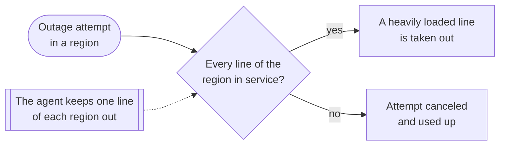

# RAD agent for grid topology and dispatch control

This is the agent our team, RAD, built during the L2RPN AI4RealNet 2026 competition. It operates a 118-bus
transmission grid (Grid2Op's `l2rpn_idf_2023` environment) under adversarial line outages, using bus-bar
splitting, line switching, redispatch, curtailment, and storage. It contains no neural network and no learned
policy. Each decision comes from simulating a short list of candidate actions a few steps ahead and keeping
the one that leaves the lines least overloaded.

We share it for people working on power-grid control or on L2RPN-style problems who want to reuse parts of
it, or compare their own agents against it. The parts we found most useful:

- **Withholding one vulnerable line per region.** In this environment an outage attempt is canceled when a
  line of its region is already out of service, so keeping one line out removes almost all outages that would
  otherwise occur (2,360 down to 64 over our 764 local scenarios).
- **An AC-anchored dispatch problem.** A convex quadratic program sets redispatch, curtailment, and storage
  together. It starts from the observed AC flows, uses the PTDF only for the change it causes, and keeps a
  reserve of downward ramping capacity.
- **An LODF screen for line openings.** It predicts the loading after opening each line with one matrix
  product per candidate, without a power-flow solve.
- **A record of postures for scheduled outages.** Before a planned outage, the agent applies a configuration
  that was observed offline to survive it.
- **A cautious rule for re-fitting parameters.** A fitted value is replaced only if the new one wins clearly on
  fresh data, which protected the agent once in the competition.

## Why withholding one line works

The environment's adversary attacks one region at a time, but an attempt only goes ahead if every line of
that region is in service. Keeping one line of each region out of service, chosen offline so the grid stays
safe without it, cancels the attempts, and a canceled attempt is used up rather than postponed:



## How a decision is made

The environment advances in five-minute steps. At each step:


[`docs/code_map.md`](docs/code_map.md) points to the function behind each box and shows how to switch each
mechanism off.

## Results

In the competition the agent was scored on two sets of 208 scenarios it had never seen:

| | completed | score | operations | low-carbon | total agent time |
|---|---|---|---|---|---|
| Validation set | 184 / 208 | 72.93 | 66.97 | 96.76 | 17,384 s |
| Final test set | 189 / 208 | 64.39 | 56.32 | 96.68 | 13,177 s |

Among the five top-ranked entries, it had the second-best ratio of score to computation time. On our local
set of 764 scenarios it completes 706.

We measured each mechanism by running two versions of the agent that differ only in that mechanism, on the
same 764 scenarios:

<picture>
  <source media="(prefers-color-scheme: dark)" srcset="docs/figures/mechanisms_dark.png">
  
</picture>

All of these numbers come from the records in [`results/`](results/), and
`python analysis/reproduce_results.py` recomputes them.

## Getting started

You need Python 3.11 or later.

```sh
pip install -r requirements.txt
python agent/xdp_agent/prepare_data.py
```

The second command downloads `l2rpn_idf_2023` and splits it into 764 training, 34 validation, and 34 test
scenarios. The lists in [`data/`](data/) let you check that you got the same split.

To watch the agent play two scenarios (a few minutes on a laptop):

```sh
python evaluation/eval_full.py --submission xdp_agent --eps "0,5" --mode fast --reference \
       --out results/my_run/check.json
```

Running all 764 scenarios takes about half an hour on one 128-core node; see
[`evaluation/README.md`](evaluation/README.md) for the laptop and SLURM versions.

## Repository layout

```
agent/xdp_agent/     the agent, a self-contained package with make_agent(env, path)
evaluation/          the harness that produced every local result
analysis/            reproduce_results.py and make_figures.py
results/             competition result files and per-scenario local records
data/                scenario lists of the 764 / 34 / 34 split
docs/                code map and figures
```

## Good to know

- The code is the version scored in the competition. For this release we only edited comments and docstrings;
  the Python syntax tree of every file is unchanged.
- The agent computes PTDF and LODF with LightSim2Grid for the environment it is built on. In the competition
  that environment was never stepped, so the factors were those of the nominal topology. Our local harness
  builds the agent on the environment it plays, so locally they follow the current topology.
- Every mechanism can be switched off with an environment variable; [`docs/code_map.md`](docs/code_map.md)
  lists them.

## Citation

If you use this code, please cite:

```bibtex
@inproceedings{rad2026rollout,
  title     = {A Rollout-Based Rule-and-Optimization Framework for Real-Time Topology and Dispatch
               Control Under Contingency Uncertainty, Developed and Tested in the {L2RPN AI4RealNet}
               2026 Challenge},
  author    = {AUTHOR_1 and AUTHOR_2},
  booktitle = {VENUE},
  year      = {2026}
}
```

## License

MIT, see [`LICENSE`](LICENSE). The vendored OptimCVXPY file keeps its MPL-2.0 license; see
[`NOTICE.md`](NOTICE.md).
