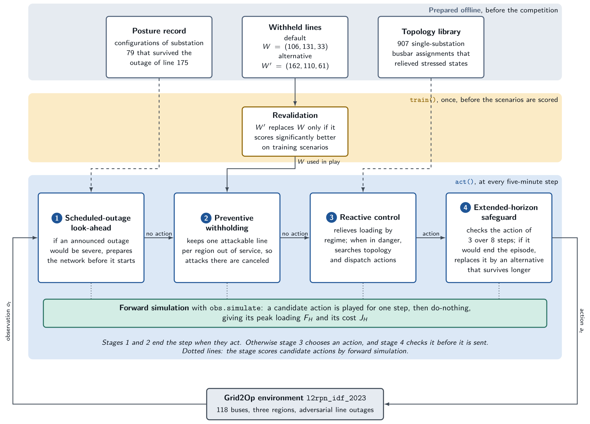

# RAD agent for grid topology and dispatch control

This repository contains the agent developed by team RAD for the L2RPN AI4RealNet 2026 competition. The agent
controls the 118-bus transmission network of the Grid2Op environment `l2rpn_idf_2023` under adversarial line
outages, acting through busbar splitting, line switching, redispatch, curtailment, and storage. It contains
no neural network and no learned policy: when the network is stressed, a bounded set of candidate actions is
simulated a few steps ahead, and the candidate with the lowest predicted cost, which penalizes overload,
curtailment, and redispatch, is applied.

## How the agent works

<p align="center">
<picture>
  <source media="(prefers-color-scheme: dark)" srcset="docs/figures/architecture_dark.png">
  
</picture>
</p>

<p align="center">
  <a href="docs/how_the_agent_works.md"></a>
</p>

## Components

The controller combines six components, each of which can be studied or reused on its own.

1. *Preventive withholding.* In this environment, an outage attempt in a region proceeds only if every
   attackable line of that region is in service. Keeping one line per region out of service therefore
   cancels these attempts, which are consumed rather than postponed. Over the 764 local scenarios, realized
   outages fall from 2,468 to 62.
2. *AC-anchored dispatch.* A convex quadratic program sets redispatch, curtailment, and storage jointly. It is
   anchored on the observed AC flows, uses the power-transfer distribution factors (PTDF) only for the flow
   change it induces, and bounds each generator's request by its own ramp margin.
3. *Line-opening screen.* The loading of every line after a candidate opening is estimated with line-outage
   distribution factors (LODF), at the cost of one matrix-vector product per candidate.
4. *Scheduled-outage look-ahead.* When an announced outage would be severe, the agent prepares the network
   before it starts, with a configuration recorded offline as surviving that outage when one exists.
5. *Margin preservation.* Before redispatch is returned toward its economic set point, part of it is shifted,
   at zero net change, toward generators close to their minimum output, so that downward ramping capacity
   remains available for later corrections.
6. *Revalidation of fitted parameters.* A parameter fitted offline is replaced only when an alternative
   performs significantly better on new data.

## Results

In the competition, the agent was evaluated on two sets of 208 scenarios not available during development:

| | completed | score | operations | low-carbon | total agent time |
|---|---|---|---|---|---|
| Validation set | 184 / 208 | 72.93 | 66.97 | 96.76 | 17,384 s |
| Final test set | 189 / 208 | 64.39 | 56.32 | 96.68 | 13,177 s |

Among the five highest-ranked entries, it achieved the second-best ratio of score to computation time. The
competition also scores each agent without its training step. On the validation set, the training step
replaced the withheld lines and raised the score from 72.15 to 72.93; on the final test set, it kept the
default and the two scores coincide. On the local evaluation set of 764 scenarios, the agent completes 706.

The contribution of each mechanism was measured by switching it off, one at a time, and running the agent
again on the same 764 scenarios with the same seeds:

<p align="center">
<picture>
  <source media="(prefers-color-scheme: dark)" srcset="docs/figures/mechanisms_dark.png">
  
</picture>
</p>

Withholding and the look-ahead change completions significantly (exact McNemar test on the scenarios whose
outcome differs, p = 0.007 and p = 0.002). The effect of margin preservation on completions is within the
noise of this comparison (p = 0.30); its measurable effect is on infeasible-redispatch failures, which fall
from 13 to 7. All reported values are recomputed from the records in [`results/`](results/) by
`python analysis/reproduce_results.py`.

## Installation and usage

The code requires Python 3.11 or later.

```sh
pip install -r requirements.txt
python agent/xdp_agent/prepare_data.py
```

The second command downloads `l2rpn_idf_2023` and splits it into 764 training, 34 validation, and 34 test
scenarios; the scenario lists in [`data/`](data/) allow the split to be verified.

A run on two scenarios takes a few minutes on a laptop:

```sh
python evaluation/eval_full.py --submission xdp_agent --eps "0,5" --mode fast --reference \
       --out results/my_run/check.json
```

A complete evaluation of the 764 scenarios takes about half an hour on a 128-core node; laptop and SLURM
instructions are given in [`evaluation/README.md`](evaluation/README.md).

## Repository structure

```
.
├── agent/
│   └── xdp_agent/              the agent package, exposing make_agent(env, path)
│       ├── my_agent.py         control cycle, candidate search, safeguards and train()
│       ├── ac_dispatch.py      AC-anchored dispatch program
│       └── ...                 OptimCVXPY baseline, offline libraries and the scripts that build them
├── analysis/
│   ├── reproduce_results.py    recomputes the reported results from results/
│   └── make_figures.py         draws the results figure
├── data/                       scenario lists of the 764 / 34 / 34 split
├── docs/
│   ├── how_the_agent_works.md  step-by-step description
│   ├── code_map.md             where each mechanism lives in the code
│   └── figures/                figures and their TikZ sources
├── evaluation/
│   ├── eval_full.py            evaluation harness used for all local results
│   └── run_eval.sh             launcher for a laptop or a SLURM cluster
├── results/
│   ├── competition/            files returned by the competition's evaluation
│   └── local_764/              per-scenario records of the local runs
├── LICENSE
├── NOTICE.md
└── requirements.txt
```

## Implementation notes

The agent in `agent/xdp_agent/` is the version evaluated in the competition. Only comments and docstrings
were edited for this release; with docstrings set aside, the syntax tree of every Python file in that folder
is identical to the evaluated version.

PTDF and LODF are computed with LightSim2Grid for the environment on which the agent is constructed. In the
competition, that environment was never stepped, so the factors corresponded to the nominal topology. In the
local evaluation harness, the agent is constructed on the environment it plays, so the factors follow the
current topology.

## Funding

This work is part of the project *Power Network Optimization in the Age of Climate Extremes* with file number
VI.Vidi.233.247 of the research programme Vidi ENW, which is (partly) financed by the Dutch Research Council
(NWO) under the grant [https://doi.org/10.61686/GOOEL09973](https://doi.org/10.61686/GOOEL09973). The
project is led by Alessandro Zocca.

## Citation

```bibtex
@inproceedings{rad2026rollout,
  title     = {Real-Time Topology and Dispatch Control Under Uncertain Adversarial Attacks
               ({A} Rollout-Based Approach)},
  author    = {Krame Kadurha, David and van der Burg, Robbert and Zocca, Alessandro and Bhulai, Sandjai},
  booktitle = {VENUE},
  year      = {YEAR}
}
```

## License

The code is released under the MIT license ([`LICENSE`](LICENSE)). The vendored OptimCVXPY file retains its
MPL-2.0 license ([`NOTICE.md`](NOTICE.md)).
