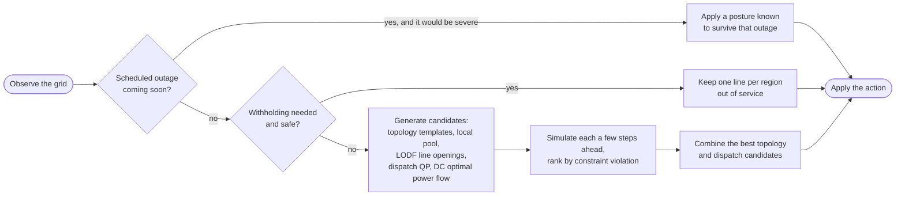
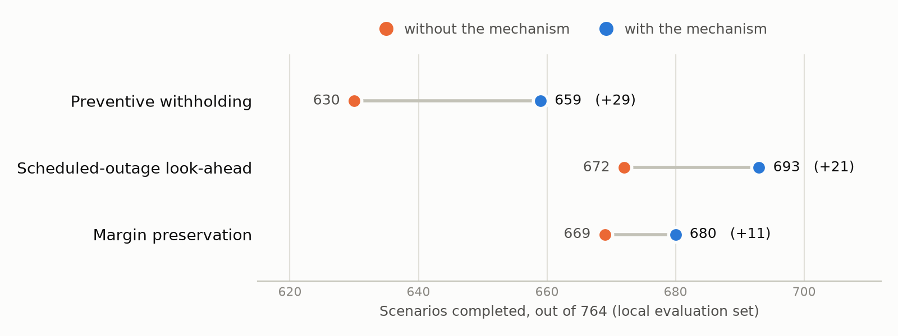

# A Rollout-Based Rule-and-Optimization Controller for Transmission Topology and Dispatch

Code and data accompanying the paper *A Rollout-Based Rule-and-Optimization Framework for Real-Time
Topology and Dispatch Control Under Contingency Uncertainty, Developed and Tested in the L2RPN AI4RealNet
2026 Challenge*.

The controller manages a 118-bus transmission network with redispatch, curtailment, storage, bus-bar
splitting, and line switching, under adversarial line outages. It trains no function approximator: at each
step it builds a bounded set of candidate actions (offline topology templates, an LODF line-opening screen, an
AC-anchored convex dispatch problem, and a DC optimal power flow), simulates each one a few steps ahead with
the environment's forecast, and applies the one with the least constraint violation. A preventive rule keeps
one line per region out of service, which removes almost all realized contingencies under the challenge's
contingency process.

## How it decides, at every five-minute step



## Results

| | completed | score | operations | low-carbon | total agent time |
|---|---|---|---|---|---|
| Challenge validation set (208 scenarios) | 184 / 208 | 72.93 | 66.97 | 96.76 | 17,384 s |
| Challenge sequestered final test set (208 scenarios) | 189 / 208 | 64.39 | 56.32 | 96.68 | 13,177 s |
| Local evaluation set (764 scenarios) | 706 / 764 | | | | |

Among the five top-ranked entries of the challenge, the agent had the second-best ratio of score to
computation time.

Each mechanism's effect was measured by a paired comparison on the 764 local scenarios, switching only that
mechanism (the paper's Table 1):

<picture>
  <source media="(prefers-color-scheme: dark)" srcset="docs/figures/mechanisms_dark.png">
  
</picture>

Every number above, and every number in the paper's Table 1, can be recomputed from the
stored records (`analysis/make_figures.py` redraws the figure):

```sh
python analysis/reproduce_paper_numbers.py
```

## Repository map

| folder | what it holds |
|---|---|
| [`agent/xdp_agent/`](agent/xdp_agent/) | the agent, as a self-contained package in the challenge's submission format |
| [`evaluation/`](evaluation/) | the full-set evaluation harness used for every local number, laptop or SLURM |
| [`analysis/`](analysis/) | `reproduce_paper_numbers.py` recomputes the reported numbers from `results/`; `make_figures.py` redraws the figure |
| [`results/platform/`](results/platform/) | the files returned by the challenge platform for the two scored runs |
| [`results/local_764/`](results/local_764/) | per-scenario records of the local runs behind Table 1 and of the published agent |
| [`data/`](data/) | the scenario lists of the local evaluation, validation and test sets |
| [`docs/code_map.md`](docs/code_map.md) | where each mechanism of the paper lives in the code, and how to switch it off |

## Quick start

Python 3.11 or later.

```sh
pip install -r requirements.txt
python agent/xdp_agent/prepare_data.py          # downloads l2rpn_idf_2023 and creates the 764/34/34 split
python evaluation/eval_full.py --submission xdp_agent --eps "0,5" --mode fast --reference \
       --out results/my_run/check.json        # two scenarios, a few minutes on a laptop
```

The split is created with grid2op's `train_val_split_random` after `env.seed(1)`; the resulting scenario
names are listed in [`data/`](data/) so the split can be checked independently.

To evaluate all 764 scenarios, see [`evaluation/README.md`](evaluation/README.md); on one 128-core node it
takes about half an hour.

## Submitting the agent to the challenge platform

The platform expects a zip whose top-level folder is `submission/` containing the package files and a
`metadata` file:

```sh
mkdir -p /tmp/pkg/submission && cp -r agent/xdp_agent/* /tmp/pkg/submission/
(cd /tmp/pkg && echo "This is internal to codabench, do not modify" > metadata && zip -r xdp_agent.zip submission metadata)
```

`train()` runs the revalidation step of Section 5.7 of the paper on the training data the platform provides,
capped at 3,600 s; `save_state()` and `load_state()` persist its outcome.

## Notes

* **The package is the one scored on the challenge platform.** For this release only code comments and
  docstrings were edited; the Python syntax trees of every file are identical to the submitted package.
* **Sensitivity factors.** The agent computes PTDF and LODF with LightSim2Grid for the environment it is
  built on. The challenge's scoring program builds the agent on a fresh environment and plays the episodes in
  separate ones, so on the platform these were the nominal topology's factors. `evaluation/eval_full.py`
  builds the agent on the environment it plays, so in local runs they follow the current topology
  (Section 4 of the paper).
* **Determinism.** Episodes are seeded by scenario index, so `evaluation/eval_full.py` reproduces a run
  record by record on the same software stack.
* **Third-party code.** See [`NOTICE.md`](NOTICE.md).
