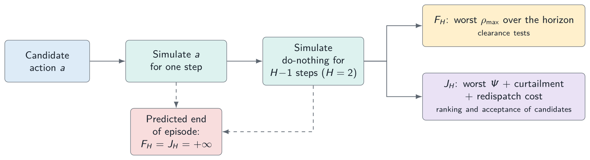
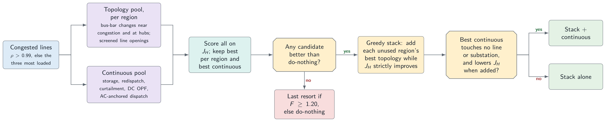
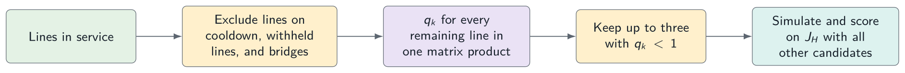
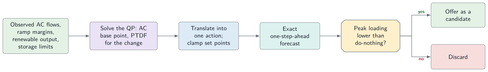
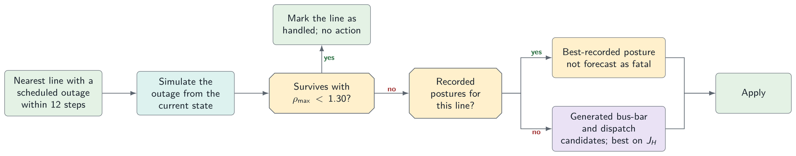

# How the agent decides

This document follows one call to `act()` from observation to returned action. It states each rule with
the threshold used in the released configuration; the functions that implement them are listed in
[`code_map.md`](code_map.md). Notation: $o$ is the current observation, $\rho_\ell$ the loading of line
$\ell$ (flow over thermal limit), $\rho_{\max}=\max_\ell \rho_\ell$, and $k_\ell$ the number of consecutive
steps line $\ell$ has been overloaded.

1. [Order of precedence](#1-order-of-precedence)
2. [How a candidate action is evaluated](#2-how-a-candidate-action-is-evaluated)
3. [Preventive withholding](#3-preventive-withholding)
4. [Operating regimes](#4-operating-regimes)
5. [Candidate search in the danger regime](#5-candidate-search-in-the-danger-regime)
6. [Line-opening screen](#6-line-opening-screen)
7. [AC-anchored dispatch](#7-ac-anchored-dispatch)
8. [Scheduled-outage look-ahead](#8-scheduled-outage-look-ahead)
9. [Margin preservation](#9-margin-preservation)
10. [Revalidation of fitted parameters in `train()`](#10-revalidation-of-fitted-parameters-in-train)
11. [Properties that hold by construction](#11-properties-that-hold-by-construction)

In the diagrams, amber marks a test or rule, teal a forward simulation, purple optimization or candidate
generation, green a state or returned action, red an adverse outcome, and blue other processing. Their
TikZ sources are in [`figures/src`](figures/src) and are rebuilt by `figures/src/build.sh`.

## 1. Order of precedence

Three layers are consulted in a fixed order, and the first that produces an action ends the step:

<p align="center">
<picture>
  <source media="(prefers-color-scheme: dark)" srcset="figures/decision_cycle_dark.png">
  
</picture>
</p>

The scheduled-outage check comes first because its deadline is published and cannot be deferred.
Withholding comes second because it can be taken on any comfortable step. The extended-horizon check at
the end replaces the controller's choice only when a line is overloaded, that choice is forecast to end
the episode within eight steps, and some alternative is forecast to survive longer than both it and the
do-nothing action. Any exception raised during the decision returns the
do-nothing action.

## 2. How a candidate action is evaluated

Every candidate, whatever its origin, is scored by forward simulation with `obs.simulate`. The candidate
is applied for one step and the do-nothing action for the remaining steps of a horizon $H=2$. Two
quantities are read from the simulated states $o_1,\dots,o_H$:

```math
F_H(o,a) = \max_{1\le h\le H} \rho_{\max}(o_h),
\qquad
J_H(o,a) = \max_{1\le h\le H} \Psi(o_h) \;+\; 0.05\,c(o_1) \;+\; 0.1\,d(o_1),
```

both equal to $+\infty$ if any simulated step ends the episode. The state term is

```math
\Psi(o) = -\sum_\ell \max(0,\,1-\rho_\ell)^2 \;+\; 200\sum_\ell \Bigl(1 + 3\,\tfrac{\min(k_\ell,K)}{K}\Bigr)\max(0,\,\rho_\ell-1)^2 ,
```

where $K$ is the number of overloaded steps the environment tolerates before disconnecting a line. The
first sum rewards spare capacity spread over the whole network rather than on the single most loaded
line; the second penalizes overloads, and more heavily on lines whose protection counter is close to
tripping. $c$ is the fraction of renewable potential curtailed, and $d$ is the cost-weighted magnitude of
redispatch, counted only when the current state is comfortable ($\rho_{\max}\le 0.90$) so that it never
competes with survival. Lower $J_H$ is better.

<p align="center">
<picture>
  <source media="(prefers-color-scheme: dark)" srcset="figures/evaluation_dark.png">
  
</picture>
</p>

$F_H$ answers whether a line remains overloaded and is used for clearance tests; $J_H$ ranks candidates
and decides whether an addition to an action is accepted. Forecasts are cached within a single decision,
since several branches query the same action; the cache is cleared at the start of every call to `act()`.

## 3. Preventive withholding

The opponent of `l2rpn_idf_2023` attacks within three regions, each with its own set of attackable lines
$\mathcal A_j$. When an attack in region $j$ falls due, the environment proceeds only if every line of
$\mathcal A_j$ is in service; otherwise the attempt is canceled and is not rescheduled. The agent
therefore holds one line $h_j\in\mathcal A_j$ out of service per region. The released default is
$(h_0,h_1,h_2)=(106,131,33)$.

The mechanism has no internal state of its own: the status of the withheld lines is the memory. It
reopens a withheld line whenever conditions allow, keeps it out under mild stress, and gives it back when
the network needs it:

<p align="center">
<picture>
  <source media="(prefers-color-scheme: dark)" srcset="figures/withholding_cycle_dark.png">
  
</picture>
</p>

The thresholds form a hysteresis: the lines are opened only in a clearly comfortable state, kept out
while loading stays at or below the thermal limits, and released once any line is overloaded, because an
open line also weakens the network. Over the 764 local scenarios, realized attacks fall from 2,360 to 64
with withholding enabled.

## 4. Operating regimes

When neither of the first two layers acts, the controller classifies the state by its current loading
and by the forecast of the do-nothing action:

| regime | condition | action |
|---|---|---|
| comfortable | $\rho_{\max}\le 0.90$ | restore curtailed renewables, charge storage, restore downward ramping capacity (Section 9), then return redispatch toward its economic set point, each guarded by a forecast |
| preventive | $\rho_{\max}>0.90$ and $F_2(o,\text{do-nothing})<1.30$ | DC optimal power flow when a line exceeds its limit, an anticipatory dispatch against the most severe likely attack, or an emergency dispatch when an overload counter is running; each must improve on do-nothing, otherwise do nothing |
| danger | $F_2(o,\text{do-nothing})\ge 1.30$ | full candidate search (Section 5) |

Two escalations move a comfortable state into the danger search. If a scheduled outage falls within the
forecast horizon, the do-nothing action is forecast even though loading is low, and a predicted end of
episode sends the step to the danger search instead of to housekeeping. Whenever a line is loaded above
0.95, the AC-anchored dispatch of Section 7 replaces the relief action chosen by these rules if its $F_H$
is lower.

Before the regimes are reached, two other rules may act. When a guarded attackable line is in service,
loaded between 0.92 and 1.00, and the most loaded attackable line of its region, a bus-bar configuration
validated offline for that line is applied, held until the threat clears, and then reverted. Recoverable
lines are reconnected one at a time when the forecast rates the reconnection no worse than doing nothing.
When both a reconnection and a relief action are available, each alone and their sum are compared on
$J_H$.

## 5. Candidate search in the danger regime

<p align="center">
<picture>
  <source media="(prefers-color-scheme: dark)" srcset="figures/danger_search_dark.png">
  
</picture>
</p>

The rules of the environment allow one substation change per region per step, so the greedy stack can
contain up to three bus-bar changes. The final step addresses a structural gap: the continuous candidate
is already built and scored, but without it a topology win in the first comparison would leave it unused.
It is added only when it touches no line or substation, so the combined action makes the same per-region
claim as the topology stack alone, and only on a strict improvement of $J_H$.

The topology pool is built twice, once from the screened action library and once from an enlarged set of
bus-bar splits around congestion. The enlarged result is played only if its $F_H$ is lower by at least
0.07, which keeps the larger pool from acting on marginal differences.

## 6. Line-opening screen

Opening a line can relieve a neighboring overload, but evaluating every opening by simulation is too
slow. For each candidate line $k$, the post-opening active flows on all lines $m$ are estimated with
line-outage distribution factors:

```math
\hat f_m^{(k)} = f_m + \mathrm{LODF}_{m,k}\, f_k,
\qquad
q_k = \max_{m\neq k} \frac{|\hat f_m^{(k)}|}{P_m^{\max}} ,
```

where $f$ are the observed flows and $P_m^{\max}$ is the thermal limit converted to active power at the
observed voltage. All $q_k$ are obtained in one matrix product.

<p align="center">
<picture>
  <source media="(prefers-color-scheme: dark)" srcset="figures/line_screen_dark.png">
  
</picture>
</p>

The screen only proposes. Each opening is still simulated and must beat the other candidates on $J_H$, so
an error of the linear estimate costs one forecast rather than an unsafe action.

## 7. AC-anchored dispatch

Redispatch, curtailment, and storage are set jointly by a convex quadratic program. The flows observed in
the AC state are the base point, and the PTDF matrix $P$ is used only for the change that the decision
induces:

```math
\Delta i = A_g\,\Delta p - A_c\,c - A_s\,s,
\qquad
\hat f = f^{\mathrm{AC}} + P\,\Delta i ,
```

with $\Delta p$ the redispatch per generator, $c\ge 0$ the curtailment per renewable unit, $s$ the storage
power (positive when charging), and $A_g, A_c, A_s$ the maps from devices to buses. For the set
$\mathcal L$ of lines loaded above 0.95,

```math
\begin{aligned}
\min_{\Delta p,\,c,\,s,\,z\ge 0}\quad & 1000\,\lVert z\rVert_2^2 + 0.03\,\lVert \Delta p\rVert_2^2 + c_c\,\mathbf 1^\top c + c_s\,\lVert s\rVert_2^2 \\
\text{s.t.}\quad & -r_g^{\downarrow}\le \Delta p_g\le r_g^{\uparrow},\qquad 0\le c_u\le p_u,\qquad \underline s_j\le s_j\le \overline s_j,\\
& \mathbf 1^\top \Delta i = 0,\qquad |\hat f_\ell| \le 0.95\,P_\ell^{\max} + z_\ell \quad (\ell\in\mathcal L),\\
& \textstyle\sum_g \max(-\Delta p_g,0) \le \sum_g r_g^{\downarrow}.
\end{aligned}
```

The last constraint keeps the total downward movement within what the fleet can deliver in one step; a
request beyond it is rejected by the environment and ends the episode. Curtailment carries a linear cost
above the other terms, because curtailed energy lowers the low-carbon score directly. When a line has a
scheduled outage within 48 steps, soft constraints on the post-outage flows
$\hat f_m + \mathrm{LODF}_{m,k}\hat f_k$ are added, with a linear penalty that is cheaper than
curtailment. The solution is translated into one action, and the action is kept only if an exact
forecast confirms a lower peak loading.

<p align="center">
<picture>
  <source media="(prefers-color-scheme: dark)" srcset="figures/ac_dispatch_dark.png">
  
</picture>
</p>

## 8. Scheduled-outage look-ahead

Maintenance outages are published in advance through `obs.time_next_maintenance`, which, unlike every
other look-ahead in the agent, is exact.

<p align="center">
<picture>
  <source media="(prefers-color-scheme: dark)" srcset="figures/outage_lookahead_dark.png">
  
</picture>
</p>

Each line is probed once per scenario. The posture record in `fatal_lines.json` holds 246 configurations
of substation 79 for line 175, ranked by the fraction of offline runs in which each survived the outage.
For that line, the record is preferred over the forecast: checked against outcomes played to the end, the
one-step forecast discarded most of the configurations that actually survived, because survival depends
on the steps after the outage, which a one-step forecast does not see. Lines without a record fall back
on generated candidates ranked by the forecast.

## 9. Margin preservation

An overload is relieved mostly by moving generation down, and a generator can move down only by the
smaller of its distance to minimum output and its ramp limit:

```math
r_g = \min\bigl(\max(p_g - p_g^{\min},\,0),\; R_g^{\downarrow}\bigr).
```

Returning redispatch toward the economic set point tends to park units at their minimum, where
$r_g=0$. In comfortable states, before that return, the agent shifts output at zero net change from units
that already hold a full ramp step ($r_g=R_g^{\downarrow}$, so giving output costs them no room) to units
near their minimum. The shift is played when it restores at least 5 MW of total downward room and the
forecast stays within the comfortable band. Over the 764 local scenarios, enabling this step raises
completed scenarios from 669 to 680 and lowers the number ending on an infeasible redispatch from 29 to
16.

## 10. Revalidation of fitted parameters in `train()`

The withheld triple was chosen offline, on local data. The competition calls `train()` on new scenarios
before scoring, and the agent uses that call to test whether a predeclared alternative is significantly
better. No model is trained.

<p align="center">
<picture>
  <source media="(prefers-color-scheme: dark)" srcset="figures/revalidation_dark.png">
  
</picture>
</p>

The candidates are fixed in the package: the default $(106,131,33)$ and the challenger $(162,110,61)$.
Every candidate is checked to contain exactly one attackable line per region, the default is restored
after scoring whatever happens, and a missing or malformed override file leaves the default in place.
`save_state()` and `load_state()` write and read only this file.

The competition scores each submission both without and with its training step. The two outcomes, taken
from the agent's own log in [`results/competition`](../results/competition):

| | training decision (10 scenarios per candidate) | score without training | score with training |
|---|---|---|---|
| validation set | difference +16.48 > margin 15.26: challenger accepted | 72.150 | 72.929 |
| final test set | difference −4.19 < margin 9.07: default kept | 64.391 | 64.391 |

With ten scenarios per candidate, the test has little power, and the decision can differ from one set of
training scenarios to the next, as it did here. The margin makes a change rare, so that a fitted value is
replaced only on clear evidence.

## 11. Properties that hold by construction

| property | holds because |
|---|---|
| Withholding is never undone by a composed action | relief is added to the opening only if it changes no line status, and the opening is always kept |
| A composed action makes no additional per-region claim | the continuous part of a composition must touch no line or substation |
| A screened line opening cannot split the network | bridges have non-finite LODF columns and are excluded |
| A linear-model error cannot reach the grid unchecked | every proposal from the LODF screen and both optimizers is simulated before it is played |
| Training cannot leave the agent in an invalid configuration | candidates are validated, the default is restored after scoring, and an invalid override file is ignored |
| The environment is not modified | all quantities are read from the observation, the parameters, or the backend; nothing is written to them |

The guarantees concern the construction of actions, not their outcome. A lower $J_H$ on the forecast
does not guarantee a better outcome several steps later, the forecast does not include the opponent, and
the DC distribution factors are not an AC security assessment.
