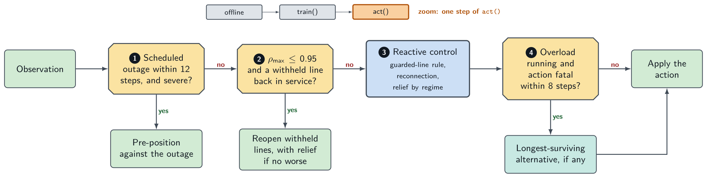
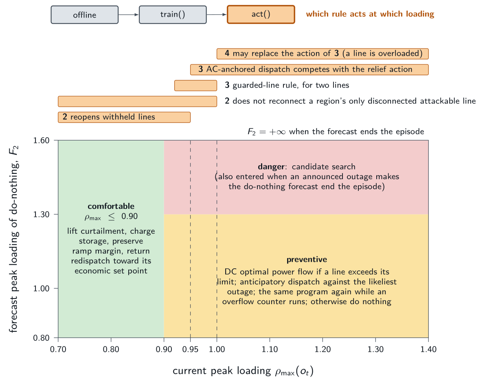
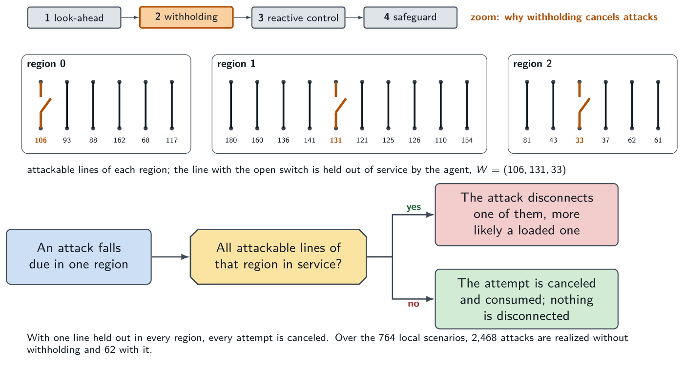
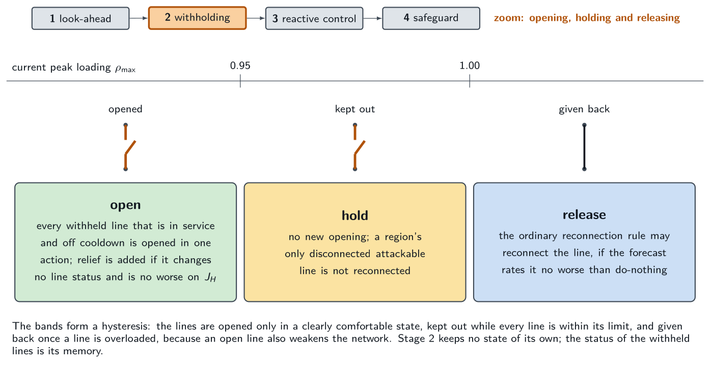
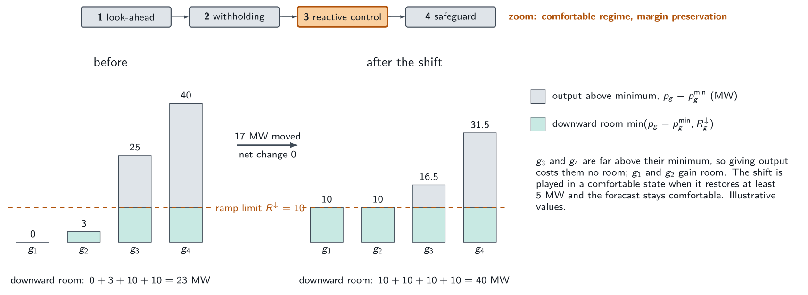
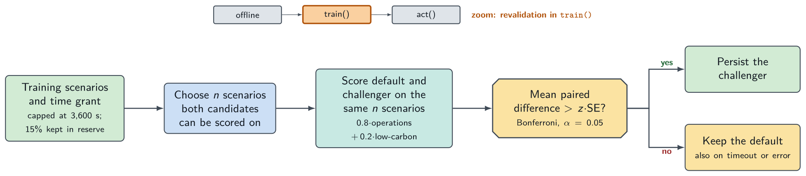

# How the agent works

Thresholds are those of the released configuration, and [`code_map.md`](code_map.md) gives the function
that implements each rule. The strip at the top of each figure marks, in orange, the part of the overview
that the figure details.

Notation: $o$ is the current observation, $\rho_\ell$ the loading of line $\ell$ (flow over thermal
limit), $\rho_{\max}=\max_\ell \rho_\ell$, and $k_\ell$ the number of consecutive steps line $\ell$ has
been overloaded.

0. [The system at a glance](#0-the-system-at-a-glance)
1. [One step of `act()`](#1-one-step-of-act)
2. [How every candidate is scored](#2-how-every-candidate-is-scored)
3. [Stage 1: scheduled-outage look-ahead](#3-stage-1-scheduled-outage-look-ahead)
4. [Stage 2: preventive withholding](#4-stage-2-preventive-withholding)
5. [Stage 3: reactive control](#5-stage-3-reactive-control)
   - [5.1 Comfortable regime and margin preservation](#51-comfortable-regime-and-margin-preservation)
   - [5.2 Preventive regime](#52-preventive-regime)
   - [5.3 Danger regime: candidate search](#53-danger-regime-candidate-search)
   - [5.4 Line-opening screen](#54-line-opening-screen)
   - [5.5 AC-anchored dispatch](#55-ac-anchored-dispatch)
6. [Stage 4: extended-horizon safeguard](#6-stage-4-extended-horizon-safeguard)
7. [Revalidation in `train()`](#7-revalidation-in-train)
8. [Properties that hold by construction](#8-properties-that-hold-by-construction)

In the flow diagrams, amber marks a test or rule, teal a forward simulation, purple optimization or
candidate generation, green a state or returned action, red an adverse outcome, and blue other
processing. The TikZ sources of all figures are in [`figures/src`](figures/src) and are rebuilt by
`figures/src/build.sh`.

## 0. The system at a glance

<p align="center">
<picture>
  <source media="(prefers-color-scheme: dark)" srcset="figures/architecture_dark.png">
  
</picture>
</p>

The agent works on three time scales. Before the competition, three inputs were prepared offline: a
library of single-substation busbar assignments that relieved stressed states, a record of substation
configurations that survived the scheduled outage of line 175, and a set of withheld lines with one
alternative. Once before the scenarios are scored, `train()` tests whether the alternative should
replace the default set. At every five-minute step, `act()` consults four stages in a fixed order, and
every stage that compares candidates uses the same forward simulation ([§2](#2-how-every-candidate-is-scored)).

## 1. One step of `act()`

<p align="center">
<picture>
  <source media="(prefers-color-scheme: dark)" srcset="figures/decision_cycle_dark.png">
  
</picture>
</p>

The scheduled-outage look-ahead comes first because its deadline is published and cannot be deferred.
Withholding comes second. It acts only when $\rho_{\max}\le 0.95$ and a withheld line is back in
service, and it adds a relief action to the opening when that relief is no worse. The extended-horizon
safeguard comes last because it judges the action that reactive
control has chosen. Any exception raised during the decision returns the do-nothing action.

Which rule can act depends on two loadings: the current peak loading, and the peak loading forecast for
the do-nothing action over the next two steps. The map below places every threshold of the agent on
these two axes. The bars above it show, on the same horizontal scale, where the rules outside the three
regimes can act.

<p align="center">
<picture>
  <source media="(prefers-color-scheme: dark)" srcset="figures/regimes_dark.png">
  
</picture>
</p>

## 2. How every candidate is scored

Every candidate, whatever its origin, is scored by forward simulation with `obs.simulate`. The candidate
is applied for one step and the do-nothing action for the remaining steps of a horizon $H=2$. Two
quantities are read from the simulated states $o_1,\dots,o_H$:

```math
F_H(o,a) = \max_{1\le h\le H} \rho_{\max}(o_h),
\qquad
J_H(o,a) = \max_{1\le h\le H} \Psi(o_h) \;+\; 0.05\,c(o_1) \;+\; 0.1\,d(o_1),
```

both equal to $+\infty$ if any simulated step ends the episode. The state term is

```math
\Psi(o) = -\sum_\ell \max(0,\,1-\rho_\ell)^2 \;+\; 200\sum_\ell \Bigl(1 + 3\,\tfrac{\min(k_\ell,K)}{K}\Bigr)\max(0,\,\rho_\ell-1)^2 ,
```

where $K$ is the number of overloaded steps the environment tolerates before disconnecting a line. $c$ is
the fraction of renewable potential curtailed, and $d$ is the cost-weighted magnitude of redispatch,
counted only when the current peak loading is below 0.90, so that it never competes with survival. Lower $J_H$ is better.

<p align="center">
<picture>
  <source media="(prefers-color-scheme: dark)" srcset="figures/evaluation_dark.png">
  
</picture>
</p>

The right panel shows what $\Psi$ values. Below the limit, every line's spare capacity counts a little,
so the controller prefers spreading margin over the whole network rather than relieving only the most
loaded line. Above the limit, the penalty dominates, and it grows fourfold as a line's overload counter
approaches the allowance. $F_H$ answers whether a line remains overloaded and is used for clearance
tests; $J_H$ ranks candidates and decides whether an addition to an action is accepted. Forecasts are
cached within a single decision, since several branches query the same action; the cache is cleared at
the start of every call to `act()`.

## 3. Stage 1: scheduled-outage look-ahead

Maintenance outages are published in advance through `obs.time_next_maintenance`, which, unlike every
other look-ahead in the agent, is exact.

<p align="center">
<picture>
  <source media="(prefers-color-scheme: dark)" srcset="figures/outage_lookahead_dark.png">
  
</picture>
</p>

Each line is probed once per scenario. The posture record in `fatal_lines.json` holds 246 configurations
of substation 79 for line 175, ranked by the fraction of offline runs in which each survived the outage.
For that line, the record is preferred over the forecast: checked against outcomes played to the end,
the one-step forecast discarded most of the configurations that actually survived, because survival
depends on the steps after the outage, which a one-step forecast does not see. Lines without a record
fall back on generated candidates ranked by the forecast.

Over the 764 local scenarios, the look-ahead acts in 68. Switching it off lowers the number of completed
scenarios from 706 to 689, and every scenario whose outcome changes is one in which it acted.

## 4. Stage 2: preventive withholding

The opponent of `l2rpn_idf_2023` attacks within three regions, each with its own set of attackable lines
$\mathcal A_j$. When an attack in region $j$ falls due, the environment proceeds only if every line of
$\mathcal A_j$ is in service; otherwise the attempt is canceled and is not rescheduled. The agent
therefore holds one line $h_j\in\mathcal A_j$ out of service per region. The released default is
$(h_0,h_1,h_2)=(106,131,33)$.

<p align="center">
<picture>
  <source media="(prefers-color-scheme: dark)" srcset="figures/withholding_rule_dark.png">
  
</picture>
</p>

The mechanism has no internal state of its own: the status of the withheld lines is the memory. It opens
a withheld line whenever conditions allow, keeps it out under mild stress, and gives it back when the
network needs it:

<p align="center">
<picture>
  <source media="(prefers-color-scheme: dark)" srcset="figures/withholding_cycle_dark.png">
  
</picture>
</p>

Over the 764 local scenarios, switching withholding off raises the number of realized attacks from 62 to
2,468 and lowers the number of completed scenarios from 706 to 679.

## 5. Stage 3: reactive control

When neither of the first two stages acts, two rules may act before the regimes are reached. When a
guarded attackable line is in service, loaded between 0.92 and 1.00, and the most loaded attackable line
of its region, a busbar configuration validated offline for that line is applied, held until the threat
clears, and then reverted. Recoverable lines are reconnected one at a time when the forecast rates the
reconnection no worse than doing nothing.

The controller then classifies the state by its current loading and by the forecast of the do-nothing
action, as in the map of [§1](#1-one-step-of-act):

| regime | condition | action |
|---|---|---|
| comfortable | $\rho_{\max}\le 0.90$ | restore curtailed renewables, charge storage, restore downward ramping capacity ([§5.1](#51-comfortable-regime-and-margin-preservation)), then return redispatch toward its economic set point, each guarded by a forecast |
| preventive | $\rho_{\max}>0.90$ and $F_2(o,\text{do-nothing})<1.30$ | DC optimal power flow when a line exceeds its limit, an anticipatory dispatch against the most severe likely attack, or the same program again when an overload counter is running; each must improve on do-nothing, otherwise do nothing ([§5.2](#52-preventive-regime)) |
| danger | $F_2(o,\text{do-nothing})\ge 1.30$ | full candidate search ([§5.3](#53-danger-regime-candidate-search)) |

If a scheduled outage falls within the forecast horizon, the do-nothing action is forecast even in a
comfortable state, and a predicted end of episode sends the step to the danger search instead of to
housekeeping. Whenever a line is loaded above 0.95, the AC-anchored dispatch of [§5.5](#55-ac-anchored-dispatch) replaces
the relief action chosen by these rules if its $F_H$ is lower. When both a reconnection and a relief
action are available, each alone and their sum are compared on $J_H$.

### 5.1 Comfortable regime and margin preservation

In a comfortable state, the controller first lifts curtailment, when more than 2% of renewable potential
is curtailed. It takes the largest lift that the forecast allows and that keeps the added renewable
output at least 30 MW below the fleet's downward ramping capacity, then adds one ramp-limited step of
redispatch toward the economic set point if the forecast allows it. Otherwise it charges storage when
renewable output is high, then adds margin preservation if it is available, or else the redispatch step.

An overload is relieved mostly by moving generation down, and a generator can move down only by the
smaller of its distance to minimum output and its ramp limit:

```math
r_g = \min\bigl(\max(p_g - p_g^{\min},\,0),\; R_g^{\downarrow}\bigr).
```

Returning redispatch toward the economic set point tends to park units at their minimum, where
$r_g=0$. In comfortable states, before that return, the agent shifts output at zero net change from units
that already hold a full ramp step ($r_g=R_g^{\downarrow}$, so giving output costs them no room) to units
near their minimum:

<p align="center">
<picture>
  <source media="(prefers-color-scheme: dark)" srcset="figures/margin_dark.png">
  
</picture>
</p>

The shift is played when it restores at least 5 MW of total downward room and the forecast stays within
the comfortable band. Over the 764 local scenarios, switching this step off raises the number of
scenarios ending on an infeasible redispatch from 7 to 13. Completions fall from 706 to 697, but that
difference is within the noise of the comparison: 34 scenarios complete only with the step and 25 only
without it (exact McNemar p = 0.30).

### 5.2 Preventive regime

In the preventive regime, the controller tries three actions in order and plays the first that passes
its check. When a line exceeds its limit, the DC optimal power flow of OptimCVXPY is played if it lowers
$J_H$ below that of do-nothing. Otherwise, if disconnecting the most loaded attackable line, the most
likely target, would push the peak loading above 1.7 at the next step, the same program is solved on that
simulated state, and its solution is played if the one-step forecast shows no end of episode and a peak
loading of at most 1.10; this anticipatory path then pauses for eight steps outside the comfortable
regime. Finally, when a line is overloaded and its counter is running, the same program is solved again
and played if the one-step peak loading falls below the current one. If none applies, the agent does
nothing.

### 5.3 Danger regime: candidate search

<p align="center">
<picture>
  <source media="(prefers-color-scheme: dark)" srcset="figures/danger_search_dark.png">
  
</picture>
</p>

The rules of the environment allow one substation change per region per step, so the greedy stack can
contain up to three busbar changes. The final step addresses a structural gap: the continuous candidate
is already built and scored, but without it a topology win in the first comparison would leave it unused.
It is added only when it touches no line or substation, so the combined action makes the same per-region
claim as the topology stack alone, and only on a strict improvement of $J_H$.

### 5.4 Line-opening screen

Opening a line can relieve a neighboring overload, but evaluating every opening by simulation is too
slow. For each candidate line $k$, the post-opening active flows on all lines $m$ are estimated with
line-outage distribution factors:

```math
\hat f_m^{(k)} = f_m + \mathrm{LODF}_{m,k}\, f_k,
\qquad
q_k = \max_{m\neq k} \frac{|\hat f_m^{(k)}|}{P_m^{\max}} ,
```

where $f$ are the observed flows and $P_m^{\max}$ is the thermal limit converted to active power at the
observed voltage. All $q_k$ are obtained in one matrix product. The example below shows the estimate on
four buses, where opening the line that carries 20 MW into an overloaded corridor relieves it:

<p align="center">
<picture>
  <source media="(prefers-color-scheme: dark)" srcset="figures/line_screen_dark.png">
  
</picture>
</p>

The screen only proposes. Each opening is still simulated and must beat the other candidates on $J_H$, so
an error of the linear estimate costs one forecast rather than an unsafe action.

### 5.5 AC-anchored dispatch

Redispatch, curtailment, and storage are set jointly by a convex quadratic program. The flows observed in
the AC state are the base point, and the PTDF matrix $P$ is used only for the change that the decision
induces:

```math
\Delta i = A_g\,\Delta p - A_c\,c - A_s\,s,
\qquad
\hat f = f^{\mathrm{AC}} + P\,\Delta i ,
```

with $\Delta p$ the redispatch per generator, $c\ge 0$ the curtailment per renewable unit, $s$ the storage
power (positive when charging), and $A_g, A_c, A_s$ the maps from devices to buses. For the set
$\mathcal L$ of lines loaded above 0.95,

```math
\begin{aligned}
\min_{\Delta p,\,c,\,s,\,z\ge 0}\quad & 1000\,\lVert z\rVert_2^2 + 0.03\,\lVert \Delta p\rVert_2^2 + c_c\,\mathbf 1^\top c + c_s\,\lVert s\rVert_2^2 \\
\text{s.t.}\quad & -r_g^{\downarrow}\le \Delta p_g\le r_g^{\uparrow},\qquad 0\le c_u\le p_u,\qquad \underline s_j\le s_j\le \overline s_j,\\
& \mathbf 1^\top \Delta i = 0,\qquad |\hat f_\ell| \le 0.95\,P_\ell^{\max} + z_\ell \quad (\ell\in\mathcal L).
\end{aligned}
```

<p align="center">
<picture>
  <source media="(prefers-color-scheme: dark)" srcset="figures/ac_dispatch_dark.png">
  
</picture>
</p>

The per-generator bounds keep each request within the ramp margin of its unit, so the total downward
movement stays within what the fleet can deliver in one step. Curtailment carries a linear cost
above the other terms, because curtailed energy lowers the low-carbon score directly. When a line has a
scheduled outage within 48 steps, soft constraints on the post-outage flows
$\hat f_m + \mathrm{LODF}_{m,k}\hat f_k$ are added, with a linear penalty that is cheaper than
curtailment. The solution is translated into one action, and the action is kept only if the forecast
confirms a lower peak loading $F_H$ than do-nothing.

## 6. Stage 4: extended-horizon safeguard

The two-step forecast of [§2](#2-how-every-candidate-is-scored) can miss an overload that ends the episode a few steps later. When a
line is overloaded, its counter is running, and the action chosen by reactive control is forecast to end
the episode within $H'=8$ steps, up to 20 alternatives are simulated over the same eight steps and ranked
by how long they survive, with ties broken by lower peak loading. The best one replaces the action only if
it survives longer than both that action and do-nothing.

## 7. Revalidation in `train()`

The withheld set was chosen offline, on local data. The competition calls `train()` on new scenarios
before scoring, and the agent uses that call to test whether a predeclared alternative is significantly
better. No model is trained.

<p align="center">
<picture>
  <source media="(prefers-color-scheme: dark)" srcset="figures/revalidation_dark.png">
  
</picture>
</p>

The candidates are fixed in the package: the default $(106,131,33)$ and the challenger $(162,110,61)$.
Every candidate is checked to contain exactly one attackable line per region, the default is restored
after scoring whatever happens, and a missing or malformed override file leaves the default in place.
`save_state()` and `load_state()` write and read only this file.

The competition scores each submission both without and with its training step. The two outcomes, taken
from the agent's own log in [`results/competition`](../results/competition):

| | training decision (10 scenarios per candidate) | score without training | score with training |
|---|---|---|---|
| validation set | difference +16.48 > margin 15.26: challenger accepted | 72.150 | 72.929 |
| final test set | difference −4.19 < margin 9.07: default kept | 64.391 | 64.391 |

With ten scenarios per candidate, the test has little power, and the decision can differ from one set of
training scenarios to the next, as it did here. The margin makes a change rare, so that a fitted value is
replaced only on clear evidence.

## 8. Properties that hold by construction

| property | holds because |
|---|---|
| Withholding is never undone by a composed action | relief is added to the opening only if it changes no line status, and the opening is always kept |
| A composed action makes no additional per-region claim | the continuous part of a composition must touch no line or substation |
| A screened line opening cannot split the network | bridges have non-finite LODF columns and are excluded |
| A linear-model error cannot reach the grid unchecked | every proposal from the LODF screen and both optimizers is simulated before it is played |
| Training cannot leave the agent in an invalid configuration | candidates are validated, the default is restored after scoring, and an invalid override file is ignored |
| The environment is not modified | all quantities are read from the observation, the parameters, or the backend; nothing is written to them |

The guarantees concern the construction of actions, not their outcome. A lower $J_H$ on the forecast
does not guarantee a better outcome several steps later, the forecast does not include the opponent, and
the DC distribution factors are not an AC security assessment.
